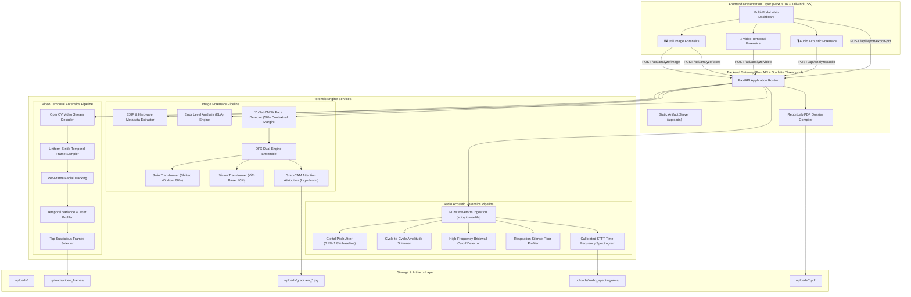
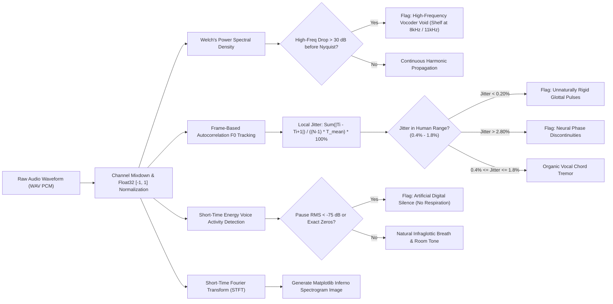

# DFX — Technical Architecture & Forensic Pipeline Specification

This document provides a comprehensive technical overview of the **Deepfake Forensics AI (DFX)** architecture, data flow, mathematical model ensembles, and explainability workflows.

---

## 1. System Architecture Diagram

---

## 2. End-to-End Analysis Lifecycle (Sequence Diagram)

```mermaid
sequenceDiagram
    autonumber
    actor User as Forensic Examiner
    participant FE as Next.js Dashboard
    participant API as FastAPI Gateway
    participant CV as Vision / YuNet Engine
    participant ML as Dual-Engine (Swin + ViT)
    participant CAM as Grad-CAM Explainer
    participant PDF as ReportLab Generator

    User->>FE: Upload Still Image / Video / Audio File
    FE->>API: POST /api/analyze/... (Multipart Payload)
    
    rect rgb(20, 25, 40)
        Note over API,CV: Spatial & Geometric Processing
        API->>CV: Detect Face Bounding Boxes (YuNet ONNX)
        CV-->>API: Extracted Faces with 50% Anatomical Margin
    end

    rect rgb(30, 25, 45)
        Note over API,ML: Dual-Engine Ensemble Inference
        API->>ML: Inference with Swin-Transformer (60%)
        API->>ML: Inference with ViT-Base (40%)
        ML-->>API: Combined Fake Score & Distance-to-Boundary Uncertainty
    end

    rect rgb(25, 35, 45)
        Note over API,CAM: Spatial Attribution & Explainability
        API->>CAM: Compute Backward Activation on model.vit.layers[-1]
        CAM-->>API: Normalized Heatmap Overlay & Focal Region Tag
    end

    API-->>FE: Return Structured JSON (Verdict, Scores, Heatmap Data URL)
    FE->>User: Display Bounding Boxes, Metrics, and Heatmaps

    opt Export PDF Report
        User->>FE: Click "Download PDF Dossier"
        FE->>API: POST /api/report/export-pdf (Dossier JSON)
        API->>PDF: Render ISO/IEC 27037 Compliant Vector Document
        PDF-->>API: Generated Binary PDF File
        API-->>FE: Stream Application/PDF Attachment
        FE-->>User: Trigger Browser File Download
    end
```

---

## 3. Dual-Engine Calibration & Decision Flowchart

DFX rejects uncalibrated binary thresholding in favor of a consensus ensemble with probabilistic uncertainty estimation:

```mermaid
flowchart TD
    Input["Input Contextual Face Crop (224x224 RGB)"] --> SwinModel["Swin Transformer (Hierarchical Shifted-Window)"]
    Input --> ViTModel["Vision Transformer (ViT-Base Patch Embeddings)"]

    SwinModel -->|P_swin_fake| Ensemble["Weighted Linear Consensus Ensemble"]
    ViTModel -->|P_vit_fake| Ensemble

    Ensemble --> CalcCombined["P_fake = 0.60 * P_swin + 0.40 * P_vit<br>P_real = 100.0 - P_fake"]
    
    CalcCombined --> CalcUncertainty["Uncertainty Metric = 100.0 - | P_real - P_fake |"]
    
    CalcCombined --> DecisionCheck{"Decision Thresholding"}

    DecisionCheck -->|P_fake >= 65%| Manip["Verdict: MANIPULATION INDICATED<br>Color: RED"]
    DecisionCheck -->|P_fake <= 35%| Auth["Verdict: AUTHENTIC INDICATED<br>Color: GREEN"]
    DecisionCheck -->|35% < P_fake < 65% or Uncertainty > 60%| Inconcl["Verdict: INCONCLUSIVE / ELEVATED UNCERTAINTY<br>Color: AMBER"]

    Manip --> OutputDossier["Output Forensic Assessment & Grad-CAM Focal Region"]
    Auth --> OutputDossier
    Inconcl --> OutputDossier
```

---

## 4. Audio Acoustic Resonance & Speech Biometrics Pipeline

---

## 5. Technical Stack Matrix

| Subsystem | Technology | Purpose |
| :--- | :--- | :--- |
| **Frontend Framework** | Next.js 16 (React 19, TypeScript) | Client-side reactive interface with dark-mode forensic theme |
| **Styling** | Tailwind CSS v4 | High-density information dashboards and responsive controls |
| **Backend REST API** | FastAPI + Uvicorn | Asynchronous endpoint routing and threadpool dispatching |
| **Face Detection** | YuNet ONNX (OpenCV DNN) | Ultra-fast CPU facial landmark and bounding box tracking |
| **Primary Vision Model** | Swin Transformer (`umm-maybe/AI-image-detector`) | Hierarchical shifted-window self-attention for studio specificity |
| **Secondary Vision Model** | Vision Transformer (`dima806/deepfake_vs_real_image_detection`) | Global attention for patch-level GAN synthesis artifacts |
| **Visual Explainability** | Grad-CAM (`pytorch-grad-cam`) | LayerNorm spatial attribution maps |
| **Video Decoding** | OpenCV (`cv2.VideoCapture`) | Frame extraction with uniform temporal stride sampling |
| **Audio Digital Signal Processing**| SciPy (`scipy.signal`, `scipy.io.wavfile`) | Glottal pitch autocorrelation, spectral flatness, and STFT |
| **Dossier Compilation** | ReportLab 5.1 | Formal vector PDF forensic examination certificates |

