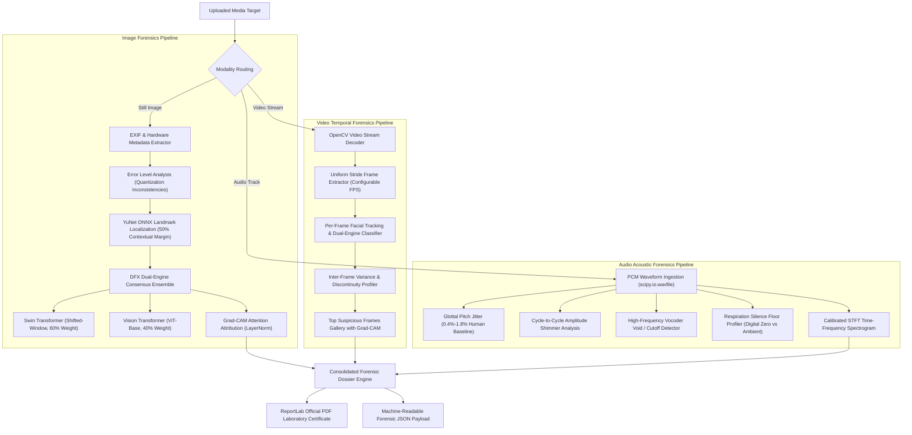

# Deepfake Forensics AI (DFX)
### Multi-Modal Explainable Digital Media Authentication & Forensics Platform

**DFX (Deepfake Forensics AI)** is an AI-powered forensic examination platform designed to detect, analyze, and explain facial manipulation, synthetic generative media, video temporal splicing, and synthetic voice cloning across **Images**, **Videos**, and **Audio**.

---

## 🔬 System Architecture & Forensic Pipeline

DFX employs a defense-in-depth, multi-layer forensic analysis methodology rather than relying on a single black-box classification model:



> 📖 **Full Architectural Specification**: See [ARCHITECTURE.md](ARCHITECTURE.md) for sequence diagrams, mathematical weighting formulas, and biometric thresholds.

---

## 🚀 Key Features

1. **Dual-Engine Vision Consensus**:
   - Primary: **Swin Transformer** (Shifted-window self-attention, 60% weight, high specificity against studio/lighting false positives).
   - Secondary: **Vision Transformer (ViT-Base)** (40% weight, specialized in GAN/Diffusion synthesis artifacts).
   - **Calibrated Uncertainty**: Automatically computes distance from the 50/50 decision boundary, flagging ambiguous edge cases as `INCONCLUSIVE / ELEVATED UNCERTAINTY` rather than falsely accusing authentic portraits.

2. **Anatomical Context Preservation**:
   - Uses an optimized **50% contextual margin** around detected faces, preserving essential hairline, ear, and jawline landmarks and eliminating false-positive label flips caused by tight-box high-frequency boundary slicing.

3. **Spatial Explainability (Grad-CAM)**:
   - Target layer: `model.vit.layers[-1].layernorm_before`.
   - Computes normalized spatial attention maps and localizes anomalous focal regions (e.g., *Periorbital Region / Eyes & Bridge*, *Oral-Mandibular*, *Forehead*).

4. **Video Temporal Splicing & Discontinuity Detection**:
   - Calculates **temporal variance** of manipulation confidence across frames.
   - Accurately captures face-swap cut points and inter-frame warping jitter.

5. **Acoustic Speech Biometrics**:
   - Analyzes vocal cord physics (micro-jitter, amplitude shimmer, Wiener spectral flatness).
   - Identifies neural vocoder brickwall filter shelves (e.g., 8 kHz or 11.025 kHz cutoffs typical of HiFi-GAN/Tacotron).
   - Inspects pause intervals for unnatural mathematical digital silence ($<-75\text{ dB}$) devoid of human breathing.

6. **Formal PDF Forensic Reports**:
   - Built-in **ReportLab** PDF engine generates formal multi-page forensic dossiers with case metadata, color-coded verdict banners, metric tables, and legal non-definitive disclaimers.

---

## 📦 Directory Structure

```text
deepfake-forensics/
├── backend/
│   ├── ai-env/                  # Python 3.12 virtual environment (CPU-optimized)
│   ├── app/
│   │   ├── main.py              # FastAPI application & REST endpoints
│   │   └── services/
│   │       ├── face_detector.py      # YuNet ONNX face detection (50% margin)
│   │       ├── deepfake_detector.py  # DFX Dual-Engine classifier (Swin + ViT)
│   │       ├── explainability.py     # Grad-CAM spatial heatmap generator
│   │       ├── metadata_extractor.py # EXIF integrity & ELA analysis
│   │       ├── video_processor.py    # Temporal stride video analyzer
│   │       ├── audio_detector.py     # Acoustic biometrics & spectrogram generator
│   │       └── pdf_generator.py      # Formal PDF forensic report builder
│   │
│   ├── models/
│   │   └── face_detection_yunet_2023mar.onnx
│   │
│   ├── dataset/                 # 20-sample multi-domain benchmark dataset
│   ├── uploads/                 # Static artifact storage (heatmaps, spectrograms, frames)
│   ├── test_all_modalities.py   # Master end-to-end regression audit
│   ├── test_video_endpoint.py   # Video API test script
│   ├── test_audio_endpoint.py   # Audio API test script
│   ├── test_pdf_generator_direct.py # PDF generator verification script
│   └── requirements.txt
│
└── frontend/
    └── frontend/
        ├── src/app/
        │   ├── page.tsx         # Unified 3-tab multi-modal dashboard
        │   ├── layout.tsx       # System font configuration
        │   └── globals.css      # Dark-mode forensic theme styling
        ├── package.json
        └── next.config.ts
```

---

## 🛠️ Quickstart & Local Setup

### System Prerequisites
- **OS**: Windows 10/11
- **Python**: 3.12.x
- **Node.js**: v18+ & npm
- **Hardware**: Compatible with standard CPU (8 GB RAM, no NVIDIA CUDA GPU required)

### Step 1: Start Backend API (Port 8000)
```cmd
cd C:\Users\admin\Pictures\deepfake-forensics\backend
ai-env\Scripts\activate
uvicorn app.main:app --host 0.0.0.0 --port 8000 --reload
```
- API Base: `http://localhost:8000`
- Swagger Documentation: `http://localhost:8000/docs`

### Step 2: Start Frontend Web Dashboard (Port 3000)
```cmd
cd C:\Users\admin\Pictures\deepfake-forensics\frontend\frontend
npm run dev
```
- Web Application: `http://localhost:3000`

---

## 🧪 Master Regression Testing

To verify all forensic engines end-to-end (Image, Video, Audio, and PDF Export), run:

```cmd
cd C:\Users\admin\Pictures\deepfake-forensics\backend
ai-env\Scripts\activate
python test_all_modalities.py
```

---

## ⚖️ Forensic & Ethical Disclaimer

**Important Notice**: Model predictions produced by DFX are probabilistic indicators and acoustic/spatial feature correlations. They do **not** constitute definitive legal proof or judicial certification of manipulation. In forensic casework, algorithmic outputs must always be corroborated by independent certified forensic examiners and evaluated within the context of digital chain-of-custody.

